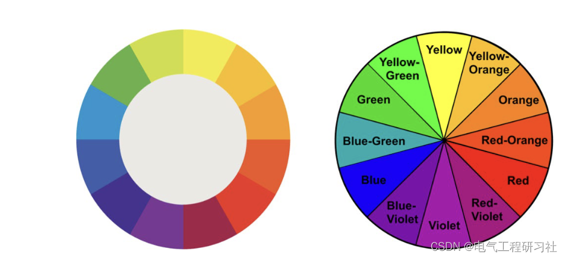
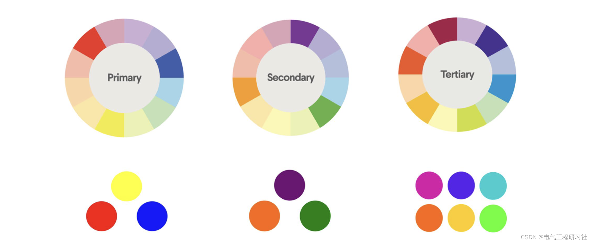
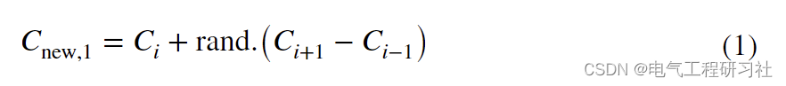
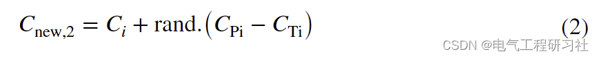
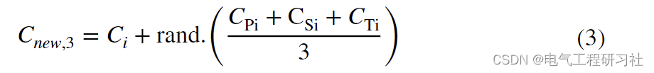
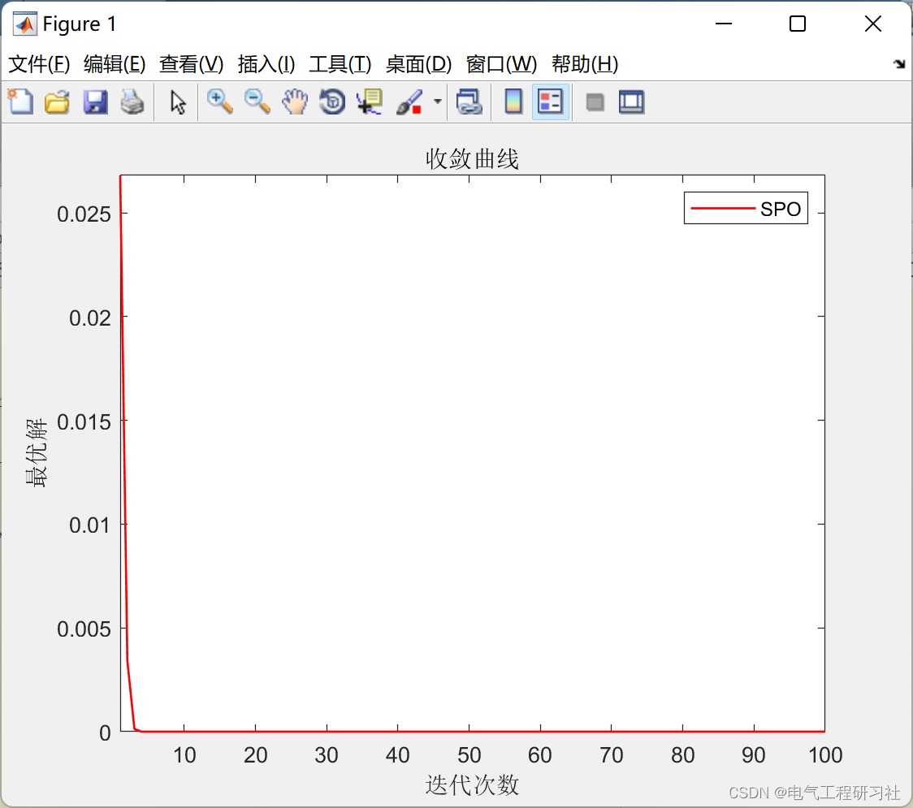

# Random Paint (SPO) Optimization Algorithm (Matlab Code Implementation)

1. Overview of the Stochastic Painting (SPO) optimization algorithm is a new algorithm proposed by Ali Kaveh and others in 2020.
This paper proposes a randomized optimizer inspired by the art of painting, called Random Painting Optimizer (SPO). SPO is an optimization algorithm inspired by the art of painting, where the beauty of colors plays a primary role in the search space. As an optimization algorithm, SPO simulates the search space as a canvas and applies different color combinations to find the optimal color. Four simple color combination rules without any internal parameters provide good exploration and development for SPO. The performance of the algorithm is evaluated through twenty-three well-known mathematical benchmark functions and validated through comparison with recently studied algorithms. Additionally, a set of IEEE Evolutionary Computation Conference benchmark functions (CEC-C06 2019) was used.On the other hand, Wilcoxon test is a nonparametric statistical test used to determine the significance of results. Finally, in order to prove the practicality of SPO, the algorithm was applied to four different structural design problems, which are known as challenging problems in civil engineering. The results of all these problems indicate that compared with other algorithms, the SPO algorithm can provide very competitive results.
This article is structured as follows: Section 2 explains the inspiration behind the algorithm; Section 3 introduces the new algorithm's formula and overview, namely the so-called Random Paint Optimizer (SPO); Section 4 addresses several numerical mathematics and structural engineering problems. Section 5 summarizes the entire article and offers suggestions for future work. Section 2 defines and conceptualizes. 2.1 Background. 2.2 Color wheel. For centuries, the color wheel has not only been used to convey various messages and religious significance but also to illustrate basic principles of color combinations or blends. To trace their historical evolution, using examples from the late 19th and early 20th centuries to distinguish between several forms based on fundamentally different relationships may be helpful.The first type includes seven colors: red, orange, yellow, green, blue, indigo, and violet. These are now generally referred to as "additive" colors, a term that was popularized by Newton in his color wheel published in 1704 [33]. Since then, scientists and artists have developed many variations of this definition. Controversy has always existed regarding which format is superior to the others.
Editor
Editor
2.3 Techniques for Combining Colors
Editor
Editor
A detailed mathematical model is provided in Section 4.
3 Random Painting Optimization Algorithm
Each type of paint requires different colors. Artists can generate these colors in an infinite variety of ways.
Artists may be attracted to a specific palette, which often defines their entire style. The technique of color combination has always been crucial in color practice, especially for painters. Many believe that the range of colors available for painting is entirely determined by the taste and elegance of the artist. Therefore, the method of choosing colors is more complex than it seems and plays a key role in the paint. It is important to understand how colors are produced and how they relate to each other to create beautiful paint. This is why art schools, colleges, and universities study color theory, focusing on the essence of color. In this article, the definition of color theory includes mathematical modeling of the color wheel and color combination techniques, aiming to serve as an optimization algorithm for the random painting optimization (SPO).
4 MATLAB Code and Article Details
This article only showcases part of the code, with all code and articles available at:
% Update the BestColors\n    [Fun_eval, SortOrder]=sort(Fun_eval);\n    Colors=Colors(SortOrder,:);\n    [SortedFit,idbest]=min(Fun_eval);\n    BestColors=Colors(idbest,:);\n    Colors=Colors(1:Colors_Number,:);\n    Fun_eval=Fun_eval(1:Colors_Number,:);\n    \n    \n    \n    \n    Conv_History(Iter)=SortedFit; % Store Best Cost Ever Found\n    \n    disp([' Iter= ',num2str(Iter),   '  BestCost= ', num2str(Conv_History(Iter))])\n    \n    plot(Conv_History,'Color','r','LineWidth',1)\n    title('Convergence curve')\n    xlabel('Iteration count');\n    ylabel('Optimal solution');\n    axis tight\n    legend('SPO')\n    \n    \nend\n\n\n%%Boundary Handling\nfunction x=bound(x,UB,LB)\nx(x>UB)=UB(x>UB); x(x<LB)=LB(x<LB);\nend\n  
Editor

## Images

<!-- PAYMENT_BLOCK -->

## Get this dataset

- Payment link (Stripe): [Buy now](https://buy.stripe.com/3cs8yP7sY87d0vu9AB)
- Payment QR code: 

<!-- /PAYMENT_BLOCK -->
